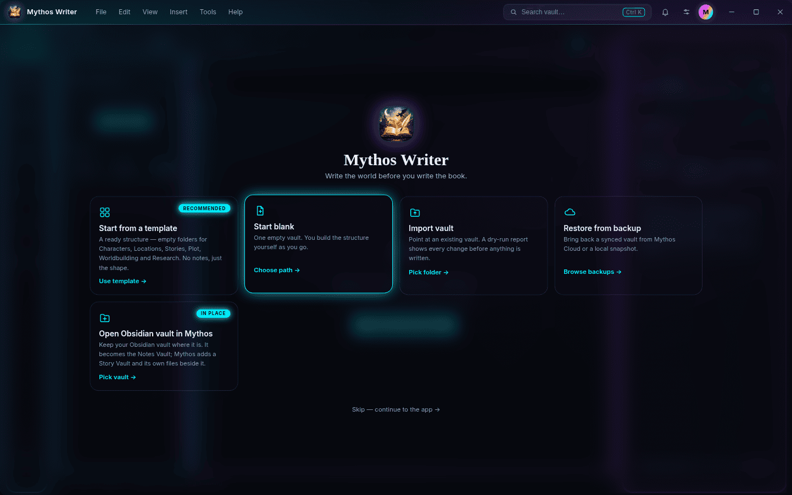
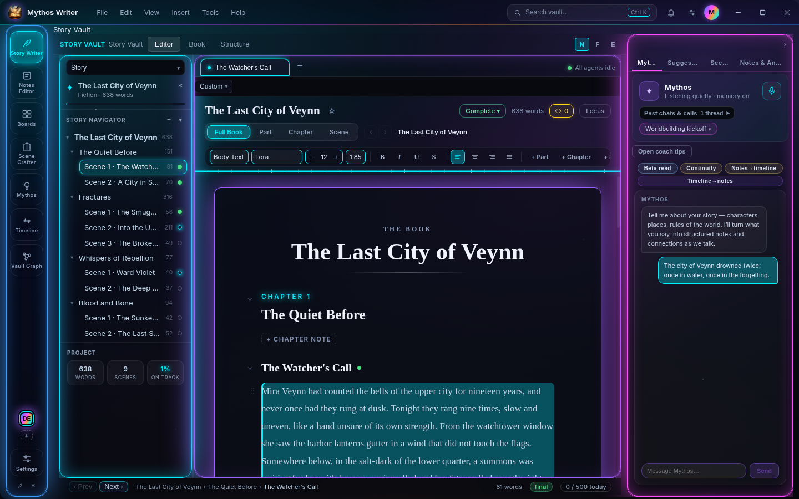
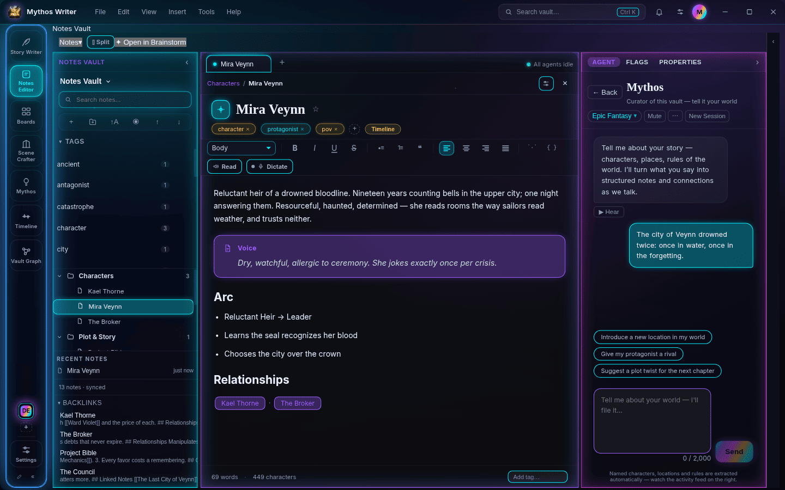
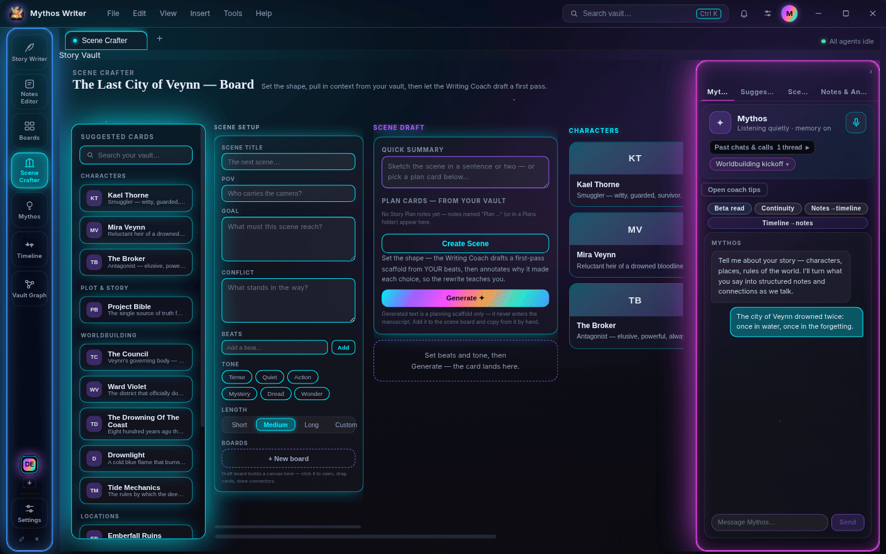
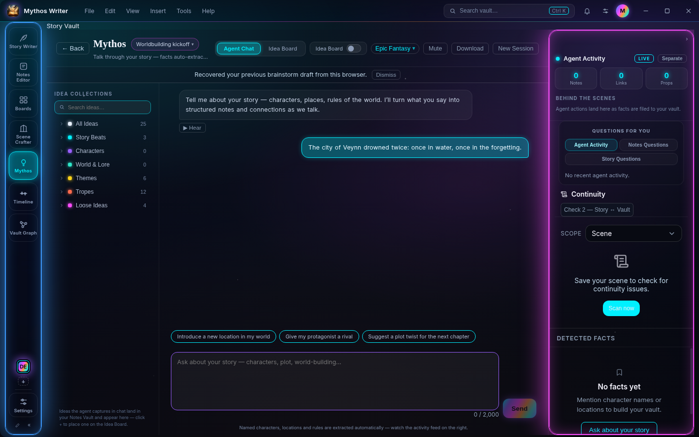
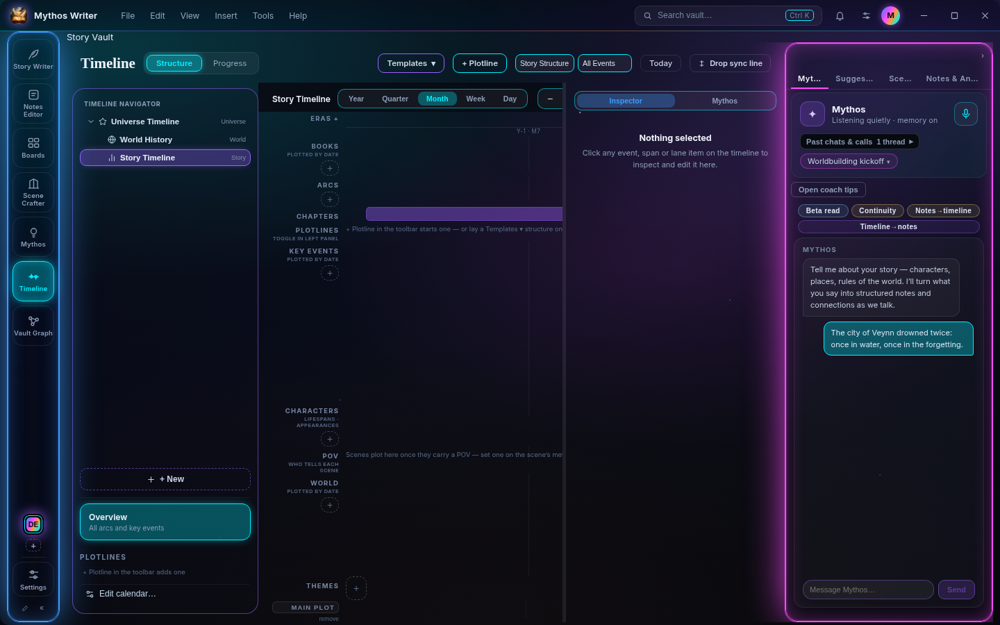
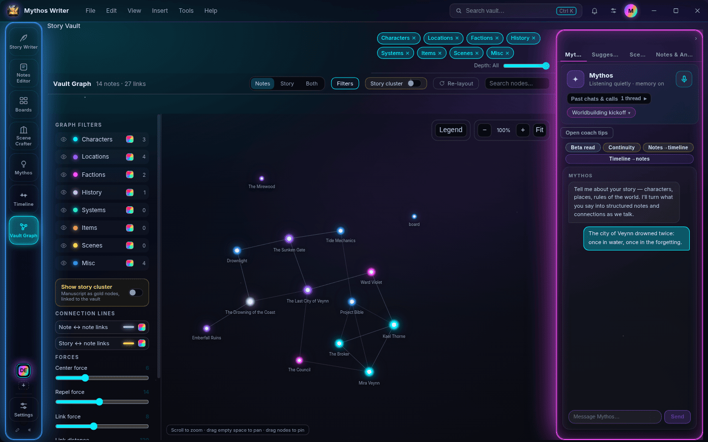
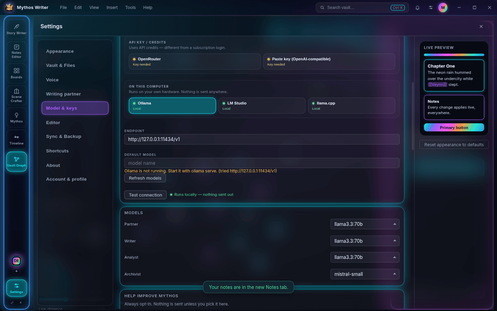

# Mythos Writer

Mythos Writer is a desktop app for fiction. Your manuscript and your notes are plain Markdown in folders on your computer. The workspace is the Liquid Neon theme: glass panels over a wallpaper you can change.

The published builds are for **Windows**. Mac and Linux are not supported releases.

AI is optional. You bring your own [OpenRouter](https://openrouter.ai/) key, or you run a model on this computer with **Ollama**, **LM Studio**, or **llama.cpp**. Settings → Model & keys can also take an OpenAI-compatible key you paste. The writing partner suggests. You write the manuscript. Scene Crafter can turn a scene setup into a draft card on a board; that card stays on the board.

## Screenshots

These are the full app window at 1440×900. The project is the demo story **The Last City of Veynn**. No AI key is connected.

### Welcome



### Story Writer



### Notes



### Scene Crafter



### Writing partner



### Timeline



### Vault Graph



### Model & keys



## Install

Download the latest Windows build from the [Releases page](https://github.com/SkyyPlayz/Mythos-Writer/releases):

| File | What it is |
| --- | --- |
| `Mythos Writer-<version>.exe` | NSIS installer |
| `Mythos Writer-<version>.zip` | Portable zip |

Run the installer, or unzip the portable build, then open **Mythos Writer**.

## First session

1. The welcome screen offers five ways to start: a template, a blank vault, an import, a restore from a local snapshot, or an Obsidian vault opened in place.
2. **From template** creates an empty Story Vault and empty Notes folders named Characters, Locations, Stories, Plot, Worldbuilding, and Research. **Start blank** creates the two vaults with nothing in the tree.
3. **Import** copies an Obsidian vault or a plain Markdown folder into a new Mythos vault. A Word manuscript on the story side is split into chapters and scenes. The folder you picked is left as it was.
4. **Open Obsidian vault in Mythos** keeps that vault where it is and uses it as the Notes vault. Mythos adds a Story vault beside it.
5. Open a scene in **Story Writer** and type. The scene is a Markdown file in the Story vault, and it saves as you write.

**Restore from backup** brings back a local snapshot. There is no cloud sync service in this build.

## The workspace

The left rail, top to bottom:

| Rail | What it is |
| --- | --- |
| Story Writer | The manuscript: book, parts, chapters, and scenes |
| Notes Editor | Markdown notes, with wiki links |
| Boards | A canvas of cards |
| Scene Crafter | Scene setup, and draft cards on a board |
| Mythos | The writing partner. The label is the name you give it; Mythos is the default |
| Timeline | Structure and Progress for the story |
| Vault Graph | A map of `[[wiki links]]` |

Settings opens from the gear in the title bar.

In Story Writer, **N / F / E** switch Normal, Focus, and Edit. Focus is `Ctrl+Shift+F`. Edit is `Ctrl+Shift+E`. Normal is `Ctrl+Shift+N`.

Type `[[` in a note or a scene to link another note. New notes can start from a template: Character, Location, Faction, Item / System, Event / History, or a blank note.

**File → Export…** writes DOCX, PDF, EPUB, Markdown, or plain text.

## AI

Open **Settings → Model & keys**.

| Choice | What you provide |
| --- | --- |
| OpenRouter | Your OpenRouter key, and the endpoint (the field suggests `https://openrouter.ai/api/v1`) |
| Paste key | An OpenAI-compatible key |
| Ollama | A local server. The default address is `http://127.0.0.1:11434/v1` |
| LM Studio | A local server. The default address is `http://127.0.0.1:1234/v1` |
| llama.cpp | A local server (`llama-server`). The default address is `http://127.0.0.1:8080/v1` |

The key is stored on this computer. A remote endpoint receives the text you send it. Ollama, LM Studio, and llama.cpp run on this computer.

The writing partner is one chat. **Update Timeline**, **Beta Read**, and **Writer Scan** are actions in that chat. Suggestions wait for you. Scene Crafter’s draft is a card on a board, produced from the setup you filled in. Adding that card opens the board. It does not write the card into the manuscript.

You can turn AI off from the same settings page. Notes, the manuscript, Boards, and the Timeline still work.

**Settings → Appearance** includes the update channel: **Stable** or **Beta**.

## Your files

A Mythos vault is a folder. Inside it, the Story vault holds the manuscript and the Notes vault holds notes. You can keep more than one vault and switch from the rail.

**Settings → Sync & Backup** shows the vault path. **Move vault…** relocates the whole vault to another folder on this computer. The same page can save and restore an app-data backup. Scene and note Markdown stays in the vault folders. **Settings → Vault & Files** can save the folder layout as a template, and it keeps scene snapshots.

**Settings → Voice** is the microphone, dictation, and speech page. It stays available when AI is off.

## Develop

- Node.js 22
- npm 10+

```bash
git clone https://github.com/SkyyPlayz/Mythos-Writer.git
cd Mythos-Writer
npm ci
npm run dev
```

`npm run dev` starts `electron-vite dev`: the React renderer hot-reloads inside Electron.

A production-shaped run, without packaging:

```bash
npm run build:electron
npm start
```

`npm start` launches `electron .` against `out/`. A Windows zip is `npm run build`. A Windows NSIS installer is `npm run build:installer`.

| Script | What it does |
| --- | --- |
| `npm run dev` | Hot-reload dev mode |
| `npm run build:electron` | Compile main, preload, and renderer to `out/` |
| `npm start` | Launch the build in `out/` |
| `npm run build` | Compile and pack a Windows zip |
| `npm run build:installer` | Compile and pack a Windows NSIS installer |
| `npm run lint` | ESLint on the frontend |
| `npm run typecheck` | `tsc --noEmit` on the frontend and the main process |
| `npm run test` | Vitest on the main process and the frontend |

The main process and the renderer talk over Electron IPC. Vault files and the SQLite database (`node:sqlite`) stay in the main process. The renderer is React 18, Vite, and TipTap.

```
electron-main/     main process, IPC, vault files
frontend/          React renderer
shared/            shared types
out/               electron-vite output (gitignored)
```

Contributor rules, including the required checks, are in [CONTRIBUTING.md](CONTRIBUTING.md).

## Update channel

**Settings → Appearance → Update Channel.**

- **Stable** is the default. The app checks for a release and asks before it installs.
- **Beta** opts into pre-releases labeled `v*.*.*-beta*` on the [Releases page](https://github.com/SkyyPlayz/Mythos-Writer/releases).
